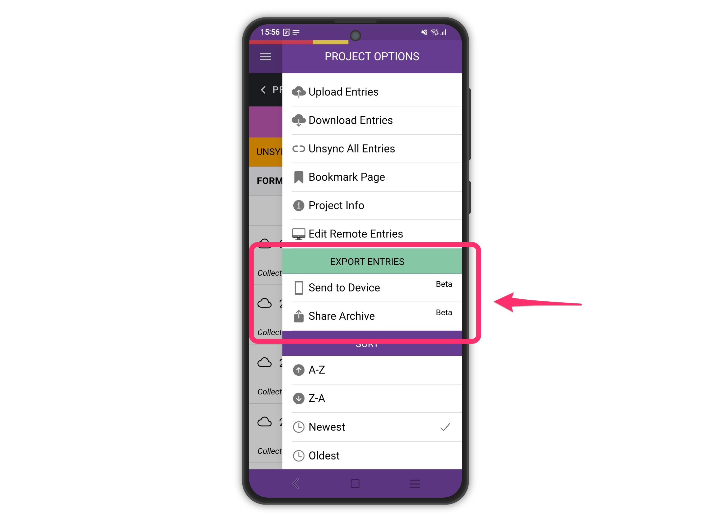

# Export Entries - Mobile

These built-in options (available since version **88.9.6**) give you flexible workflows for both automated syncing and one-off data sharing.

#### 1. Send to Device

This option allows you to **export your project entries and media directly to your device**.

* On **Android**, exported files are saved to the **Documents** folder.
* On **iOS**, exported files are saved to **My Phone**.
* The export includes:
  * CSV files of all your entries
  * Copies of all associated media (images, audio, video)

**Use case:** Ideal if you want to **set up a third-party app** (like [FolderSync](https://foldersync.io/)) to automatically sync your exported data to your cloud service of choice.

#### 2. Share Archive

This option creates an **archive of your entries and media**, packaged as a **ZIP file**, and opens the **share panel** so you can send it wherever you like.

* Includes the same CSV files and media as **Send to Device**.

**Use case:** Best for a **one-off export** when you want a single package of your data to share, backup, or send via email, cloud storage, or other apps.

#### Why Two Options?

Having both options lets you choose the workflow that fits your needs:

* **Send to Device** → For ongoing syncing with cloud services or automated workflows.
* **Share Archive** → For one-time exports or sharing with others in a single ZIP file.

<figure><figcaption></figcaption></figure>

### How to Use

1. Open the project in the Epicollect5 mobile app.
2. Tap the **menu** (⋮) and select **Send to Device** or **Share Archive**.
3. Wait for the export process to complete.
4. Check the target folder (Documents/My Phone) or use the share panel to access your ZIP file.

<figure><figcaption></figcaption></figure>

#### Project version not compatible

**Message shown in the app:** _"The current project version is not compatible. Update the project and try again."_

This message appears when you try to export entries — **Project Options → Share Archive** or **Send to Device**. It does **not** affect collecting, saving, uploading or downloading entries: only the export is blocked.

**Why this happens**

The app stores the structure of the project on the device when you add it. Part of that structure is the layout information ([See Data Mapping](../web-application/mapping-data.md)) used to build the CSV file on export.

Projects added with an older version of the app can be missing that part of the structure. Normally the app replaces the local copy as soon as it detects that the project on the server is newer, but if the project has not changed on the server since it was added, the app sees nothing to update — so the missing part is never downloaded and the export cannot be built.

This is why tapping **Export again** does not help by itself: something has to change on the project side first (see below).

> **Note:** Entries are never lost because of this. Nothing needs to be deleted and nothing needs to be re-typed.

**How to fix it**

The fix is done by the **project CREATOR or MANAGER(s)**, on the server, and takes about a minute.

1. Open the project in the form builder.
2. **Save/publish the project again** — no change is needed; saving it is enough to make it "newer" than the copy on the device.
3. On the device, go back to the **Projects** list and open the project again.
4. The app now detects the newer version and asks _"Project has been updated. Update project on your device?"_ — tap **OK** and wait for the update to finish.
5. Try the export again: **Share Archive** or **Send to Device** now works.

**Who does what**

| Role               | Action                                                                                                        |
| ------------------ | ------------------------------------------------------------------------------------------------------------- |
| Project owner      | Re-save / publish the project on the web builder so its last-updated date changes.                            |
| Collector (device) | Go back to the Projects list, open the project, accept the update prompt, then export again.                  |
| Project owner      | Only needed once per project: after that, every device that opens the project picks up the updated structure. |

> **Recommendation:** Tell collectors to upload any unsynced entries _before_ the update prompt is accepted, as you would for any project update. See the sections above for what an update keeps and what it deletes.

**If re-saving the project is not possible**

Deleting the project on the device and adding it again also replaces the local copy — but this **removes all entries stored on that device, including entries that were never uploaded**. Use it only as a last resort, and always export or upload first.
